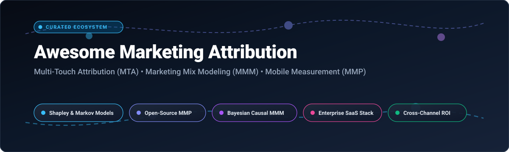

# 📊 Awesome Marketing Attribution 🎯

**A definitive curated catalog of top SaaS platforms and open-source tools for Multi-Touch Attribution (MTA), Media Mix Modeling (MMM), Mobile Measurement Partners (MMP), and Unified Marketing Measurement (UMM).**

*Track user touchpoints, solve the multi-touch attribution puzzle, evaluate Shapley & Markov chain models, optimize ROAS, and achieve complete marketing data sovereignty.*

---

## 📑 Table of Contents

- [🌐 Sector Overview & Market Dynamics](#-sector-overview--market-dynamics)
- [🏢 SaaS & Hosted Platforms](#-saas--hosted-platforms)
- [🔓 Open-Source GitHub Projects](#-open-source-github-projects)
- [🛠️ Architectural Recipes for Custom Stacks](#-architectural-recipes-for-custom-stacks)
- [🤝 How to Contribute](#-how-to-contribute)
- [💖 Support](#-support)
- [📈 Star History](#-star-history)
- [⚖️ Disclaimer](#️-disclaimer)

---

## 🌐 Sector Overview & Market Dynamics

The global marketing attribution software market is valued at approximately **$4.6B – $5.5B** and projected to surpass **$15B – $17.7B by the mid-2030s**, expanding at a CAGR of ~**13.5% – 14.6%**. 

The sector is **moderately fragmented**:
- **Enterprise Cloud Suites:** Megacap conglomerates (Salesforce, Adobe / Bizible, AppLovin) hold substantial footprint across established enterprise CRM, ad networks, and ERP environments.
- **Specialized Best-of-Breed Disruptors:** Agile players across multi-touch attribution (MTA), mobile measurement (AppsFlyer, Adjust, Singular), and B2B revenue intelligence (Dreamdata, HockeyStack, Rockerbox) command massive loyalty among digital-first brands requiring granular touchpoint pathing, causal AI, and privacy-first SKAdNetwork / Privacy Sandbox measurement.

---

## 🏢 SaaS & Hosted Platforms

The following SaaS attribution and marketing measurement platforms are sorted in descending order by **Company Size (Valuation / Revenue)**:

| Platform | Company Size (Valuation / Revenue) | Pricing (Starting Tier) | Free Tier / Free Trial Limits | Description |
| :--- | :--- | :--- | :--- | :--- |
| **[Salesforce Bizible](https://www.salesforce.com/)** | **~$260B+ Market Cap** (Salesforce; Bizible/Marketo Measure unit within Adobe/Salesforce ecosystem; Marketo acquired Bizible then acquired by Adobe for $4.75B) | Starts at **~$20,000 – $35,000/year** (Standard tier for single CRM instance, billed annually) | **No free tier or trial**; vendor evaluation requires a guided sales consultation and custom sandbox demo | B2B marketing attribution platform within Salesforce that connects ad spend to revenue with multi-touch attribution models. |
| **[AppsFlyer](https://www.appsflyer.com/)** | **$2.7B Valuation** (~$500M ARR; Series E) | Starts at **$0.07/conversion** (Growth plan pay-as-you-go after introductory allocation) | **Forever Free Zero plan** (organic installs unlimited; up to **12,000 free non-organic conversions** in Welcome Package for first 12 months + 30-day premium add-ons trial) | Mobile attribution and marketing analytics platform with deep linking, fraud protection, and audience segmentation. |
| **[Adjust](https://www.adjust.com/)** | **$1B Valuation** (Acquired by AppLovin for $1B; part of AppLovin software segment) | Core plans custom quoted (typically starting at **~$0.04 – $0.06/conversion** or minimum annual commitments) | **Free Base Plan** capped at **1,500 monthly conversions** (up to 18,000 annual conversions) for the first year with core Datascape reporting and unlimited organic installs | Mobile measurement partner with attribution, fraud prevention, and audience builder for app marketers. |
| **[Rockerbox](https://www.rockerbox.com/)** | **$85M Valuation** (Acquired by DoubleVerify for $85M) | Starts at **$1,500/month** ($18,000/year minimum contract for entry mid-market tier) | **No free tier or self-serve trial**; guided enterprise product pilot and demo provided upon qualification | Marketing attribution and measurement platform unifying cross-channel data with custom attribution models. |
| **[Dreamdata](https://dreamdata.io/)** | **$55M+ Valuation** (~$3M – $8.9M ARR; Series B funded) | Starts at **$1,250/month** ($15,000/year billed annually for Growth/Attribution tier) | **Forever Free plan** with **5 user seats, 2 months of historical data**, unlimited IP-to-company identification, up to 3 stage models, and 1 audience sync | B2B revenue attribution platform connecting marketing touchpoints to pipeline and revenue. |
| **[HockeyStack](https://hockeystack.com/)** | **~$50M Valuation** (~$9M+ ARR; $50M total funding raised) | Starts at **$1,400/month** (billed annually for core B2B tracking plan) | **No free tier or trial**; access requires scheduling a custom data architecture evaluation demo | Revenue attribution platform correlating marketing touches with closed revenue for B2B teams. |
| **[Singular](https://www.singular.net/)** | **~$50M – $55M Valuation** (~$50M+ ARR) | Starts at **~$0.05/conversion** (Growth plan starting tiers) | **Forever Free Starter tier** capped at **15,000 attributed conversions** lifetime with unlimited organic tracking, standard integrations, and reporting | Marketing analytics platform with unified attribution across mobile, web, and CTV channels. |
| **[Windsor.ai](https://windsor.ai/)** | **~$15.4M Valuation** (~$2M – $4.8M ARR) | Starts at **$19/month** (Basic tier billed annually, or $23/month billed monthly) | **Forever Free plan** for **1 user, 1 data source, 1 account**, and 5 destination tasks (following an all-inclusive 30-day free trial with 10 data sources and 15 accounts) | Marketing data connector and attribution platform unifying 100+ data sources for custom reporting. |
| **[FullCircle Insights](https://www.fullcircleinsights.com/)** | **~$10M Valuation** (~$5M ARR; $9.5M total funding) | Starts at **$4,166/month** (~$50,000/year base contract + setup fees) | **No free tier or trial**; deployment requires custom scoping and guided 1–8 week Salesforce deployment | B2B marketing attribution and funnel analytics natively built on Salesforce. |
| **[Attribution App](https://attributionapp.com/)** | **~$2M – $4M Valuation** (~$880K ARR) | Starts at **$199/month** (Shopify plan) or **$399/month** (Pro plan for up to 10k monthly visitors) | **14-day free trial** on Pro plan (full access to ad connectors and models); no permanent free tier | Multi-touch attribution and marketing analytics for e-commerce and SaaS businesses. |

---

## 🔓 Open-Source GitHub Projects

Open-source attribution libraries, media mix modeling engines, self-hosted Mobile Measurement Platforms (MMPs), and tracking pixel infrastructures. Repositories are sorted in **descending order by GitHub stars ⭐**. Beside each repository name is a social badge linking directly to its stargazer community.

- **[Snowplow](https://github.com/snowplow/snowplow)**   
  Enterprise-grade, first-party behavioral customer data pipeline and event tracking infrastructure. Foundation for building sovereign cross-platform attribution pipelines with real-time streaming into Snowflake, BigQuery, and Databricks.

- **[Robyn](https://github.com/facebookexperimental/Robyn)**   
  Meta's open-source experimental Marketing Mix Modeling (MMM) package in R and Python. Uses multi-objective evolutionary algorithms (Nevergrad) to calibrate model hyperparameters against ground-truth attribution and geo-experiments while preventing ad spend biases.

- **[PyMC-Marketing](https://github.com/pymc-labs/pymc-marketing)**   
  Bayesian marketing analytics toolkit supporting Bayesian Media Mix Modeling (MMM), Customer Lifetime Value (CLV) estimation, and saturation/adstock analysis with custom Bayesian priors.

- **[LightweightMMM](https://github.com/google/lightweight_mmm)**   
  Google's lightweight Bayesian Marketing Mix Modeling library built in Python using JAX and NumPyro. Scales to high-volume multi-channel ad spend data with Hill and Adstock transformations.

- **[OpenPixel](https://github.com/dockwa/openpixel)**   
  Open-source JavaScript tracking pixel library. Self-hostable alternative to Facebook Pixel and Google Tag Manager client library for capturing page views, conversions, UTM parameters, and custom attribution events.

- **[Snowplow Referer Parser](https://github.com/snowplow-referer-parser/referer-parser)**   
  Multi-language library (Python, Java, Scala, Ruby, Node.js) for parsing attribution data, search terms, and campaign traffic sources out of raw HTTP referrer URLs.

- **[Marketing-Attribution-Models (Nova MAM)](https://github.com/DP6/Marketing-Attribution-Models)**   
  High-performance Python library optimized with Polars and Pandas for digital marketing attribution. Calculates heuristic models (first-click, last-click, linear, time-decay, position-based) alongside algorithmic models (Markov Chains and Shapley Values).

- **[Awesome Marketing Machine Learning](https://github.com/station-10/awesome-marketing-machine-learning)**   
  Curated collection of machine learning algorithms for marketing analytics, containing multi-touch attribution (MTA), causal inference, churn modeling, and media mix models.

- **[eeghor/mta](https://github.com/eeghor/mta)**   
  Multi-touch attribution framework in Python featuring Markov Chains, transition probability matrices, and removal effects to objectively measure marketing channel contribution.

- **[dwz-server](https://github.com/muleiwu/dwz-server)**   
  Enterprise URL shortener and campaign tracking platform that combines short-link generation, multi-domain management, A/B testing, marketing attribution, and click analytics.

- **[OpenAttribution](https://github.com/OpenAttribution/open-attribution)**   
  Open-source Mobile Measurement Platform (MMP) giving app publishers complete ownership of ad attribution data. Features impression/click tracking, ClickHouse analytical storage, and transparent attribution logic for iOS/Android.

- **[Markov-Chain (Marketing Attribution)](https://github.com/MatCyt/Markov-Chain)**   
  R-based multi-channel attribution and budget reallocation engine applying discrete-time Markov chains and removal effect matrices to customer conversion journeys.

- **[Game Theory Attribution](https://github.com/jrkinley/game-theory-attribution)**   
  Data-driven multichannel marketing attribution model using cooperative game theory (Shapley Value) in Python to equitably distribute conversion credit across ad touchpoints.

- **[Attention-RNN Multi-Touch Attribution](https://github.com/jeremite/channel-attribution-model)**   
  Attention-based Recurrent Neural Network (RNN) multi-touch attribution model in Python. Learns deep non-linear conversion dynamics and assigns multi-channel credit while accounting for user context and temporal decay.

- **[Multi-Touch Attribution Shapley Value](https://github.com/bernard-mlab/Multi-Touch-Attribution_ShapleyValue)**   
  Python implementation of exact and sample-based Shapley value algorithms tailored for customer journey attribution and budget simulation.

- **[Prosper202](https://github.com/tracking202/prosper202)**   
  Veteran open-source PPC conversion tracking and click attribution software with real-time campaign profitability calculation and Docker deployment support.

- **[Marketing Attribution Data Model](https://github.com/kobzevvv/marketing-attribution-data-model)**   
  Complete marketing attribution data warehouse model in SQL for ClickHouse and BigQuery, implementing first-touch, last-touch, linear, and time-decay attribution models directly in data warehouses.

- **[Databricks Multi-Touch Attribution](https://github.com/databricks-industry-solutions/multi-touch-attribution)**   
  Databricks solution accelerator for large-scale multi-touch attribution. Combines Spark, MLflow, and graph models to evaluate touchpoint impact and optimize media mix.

- **[MultiTouchAttribution (DLAW)](https://github.com/GregMurray30/MultiTouchAttribution)**   
  Attribution simulation framework implementing Data-driven Last-touch Attribution Weighting (DLAW) with empirical MAE comparisons against traditional heuristics.

- **[Tasman dbt MTA Package](https://github.com/TasmanAnalytics/tasman-dbt-mta)**   
  Modular dbt package for calculating first-touch, last-touch, linear, U-shaped, and Markov multi-touch attribution inside cloud data warehouses.

- **[ChannelAttribution](https://github.com/DavideAltomare/ChannelAttribution)**   
  High-performance C++ backend with R and Python bindings implementing $k$-order Markov Chains and heuristic algorithms for multi-channel journey attribution.

- **[Attributor](https://github.com/Crynge/Attributor)**   
  Go-based multi-touch attribution and Bayesian media mix modeling microservice with Shapley values, Markov removal effects, and REST API endpoints.

- **[Causal MMM + MTA Platform](https://github.com/Crynge/causal-mmm-mta-platform)**   
  Python research platform combining Bayesian Marketing Mix Modeling, multi-touch attribution, causal graph discovery, and incrementality reconciliation.

- **[caddy-utm-tracker](https://github.com/xor22h/caddy-utm-tracker)**   
  Caddy v2 web server plugin for transparent server-side UTM parameter capture and asynchronous attribution event emission.

- **[adsat](https://github.com/stefanobandera1/adsat)**   
  Python advertising saturation and attribution toolkit implementing Shapley values, Markov models, and ROI-weighted budget allocation.

---

## 🛠️ Architectural Recipes for Custom Stacks

Want to eliminate recurring vendor costs and build a privacy-first, custom attribution pipeline? Here is the recommended blueprint:

1. **Client & Server Capture:** Deploy **[Snowplow](https://github.com/snowplow/snowplow)** or **[OpenPixel](https://github.com/dockwa/openpixel)** with **[caddy-utm-tracker](https://github.com/xor22h/caddy-utm-tracker)** for zero-data-loss web tracking.
2. **Mobile Attribution:** Integrate **[OpenAttribution](https://github.com/OpenAttribution/open-attribution)** for self-hosted MMP capabilities with privacy-compliant fingerprinting and deep linking.
3. **Data Warehouse & Transformation:** Ingest into **ClickHouse** or **BigQuery** using **[tasman-dbt-mta](https://github.com/TasmanAnalytics/tasman-dbt-mta)** or **[marketing-attribution-data-model](https://github.com/kobzevvv/marketing-attribution-data-model)**.
4. **Algorithmic Credit Modeling:** Execute **[Marketing-Attribution-Models](https://github.com/DP6/Marketing-Attribution-Models)** for Markov & Shapley touchpoint credit.
5. **Macro Calibration:** Calibrate top-down spend using **[Robyn](https://github.com/facebookexperimental/Robyn)** or **[PyMC-Marketing](https://github.com/pymc-labs/pymc-marketing)**.

---

## 🤝 How to Contribute

Contributions are warmly welcome! Help make this ecosystem resource even more valuable:

1. 🍴 Fork this repository.
2. 🌿 Create a feature branch (`git checkout -b feature/add-attribution-tool`).
3. 📝 Add your tool in alphabetical or star order with factual details and official links.
4. 🚀 Open a Pull Request with a clear description of why the tool belongs in this list.

---

## 💖 Support

If you find this repository helpful for your marketing engineering and attribution workflows, please consider:
- ⭐ **Starring this repository** to help others discover it.
- 🍴 **Forking and sharing** it with your growth engineering and data science teams.
- ☕ **Sponsoring the maintainer:** [GitHub Sponsors Dashboard](https://github.com/sponsors/ishandutta2007) to help support ongoing maintenance and new awesome lists!

---

## 📈 Star History

---

## ⚖️ Disclaimer

- This repository is a community-curated list for informational and educational purposes. Mention of products does not imply official endorsement.
- All attribution tracking and analytics implementations must strictly comply with regional privacy regulations (GDPR, CCPA, PECR) and mobile platform privacy guidelines (Apple App Tracking Transparency / SKAdNetwork, Google Privacy Sandbox).
- Always ensure appropriate security, hashing, and consent management are enforced when handling first-party user identifiers.
